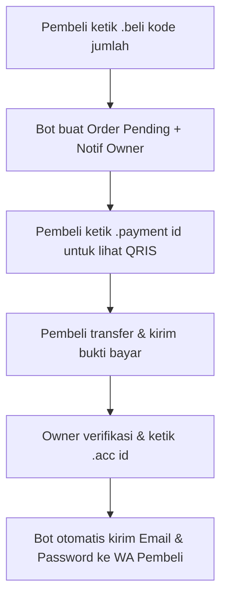

# 🛒 Bot-Jualan

WhatsApp Bot open-source berbasis Node.js (@whiskeysockets/baileys) untuk otomasi toko produk **digital** (Netflix, Spotify, Canva, Voucher, dll.) maupun **fisik**. Dilengkapi fitur katalog interaktif, auto-invoice QRIS, manajemen stok, dan pengiriman akun otomatis secara instan.

---

## Fitur Utama

- **Katalog Interaktif**: Cek produk via `.menu` dan `.shop`.
- **Auto-Invoice & QRIS**: Generate order ID dan invoice pembayaran QRIS otomatis.
- **Stok Digital & Fisik**: Mendukung stok angka (fisik) dan antrean akun / voucher (digital).
- **Auto-Delivery Instan**: Sekali klik `.acc <id>`, bot otomatis mengirimkan detail akun (email & password) langsung ke nomor WhatsApp pembeli!
- **Fitur AI CS & Broadcast**: Terintegrasi bantuan AI untuk customer service dan broadcast pesan.

---

## Manajemen Stok Produk Digital

Produk digital di bot ini dapat menyimpan kredensial akun (email, password, PIN, link redeem) secara aman di database lokal (`db/produk.json`).

### 1. Menambahkan Produk Baru
Format:
```text
.addproduk <kode>|<nama>|<tipe>|<harga>|<stok_awal>|<deskripsi>
```
*Contoh Produk Digital:*
```text
.addproduk netflix1bln|Netflix Premium 1 Bulan|digital|35000|0|Akun privat 4K UHD garansi 30 hari
```

### 2. Memasukkan Stok Akun (Email & Password)
Gunakan perintah `.addstok` dengan format pemisah pipa (`|`):
```text
.addstok <kode> <email|password>
```
*Contoh:*
```text
.addstok netflix1bln buyerone@gmail.com|passNetflix123
.addstok netflix1bln buyertwo@gmail.com|passNetflix456
```
> *Catatan:* Kamu juga bisa memasukkan link invite atau format voucher, misalnya:
> `.addstok canva https://canva.com/brand/join?token=xyz...`
> Setiap kali kamu menjalankan `.addstok`, akun akan tersimpan ke dalam antrean stok produk tersebut.

---

## Alur Transaksi & Pengiriman Akun ke Pembeli



### 1. Pengiriman Otomatis (Dari Stok Database)
Saat pembeli sudah membayar, owner cukup mengetik perintah:
```text
.acc <id_order>
```
*Contoh:*
```text
.acc ORD-8F2A
```
Bot akan secara otomatis:
1. Mengambil akun teratas dari antrean database stok.
2. Mengurangi jumlah stok produk secara real-time.
3. **Mengirimkan WhatsApp pribadi (DM) langsung ke nomor pembeli** dengan pesan seperti ini:

```text
*Pembayaran Dikonfirmasi*

ORD-8F2A — Netflix Premium 1 Bulan x1

*Detail Akun:*
1. buyerone@gmail.com|passNetflix123

Terima kasih sudah berbelanja!
```

---

### 2. Pengiriman Manual / Custom (Opsional)
Jika stok di database sedang kosong atau kamu ingin memberikan akun khusus yang baru dibuat tanpa menyimpannya ke stok terlebih dahulu, kamu bisa langsung menyertakan detail akun di belakang perintah `.acc`:
```text
.acc <id_order> <email|password_atau_keterangan>
```
*Contoh:*
```text
.acc ORD-8F2A premiumvip@gmail.com|passwordbaru2026 (Garansi 30 Hari)
```
Bot akan langsung meneruskan kredensial tersebut ke pembeli tanpa memotong stok di database!

---

## Daftar Command Lengkap

### Menu Pembeli
| Command | Parameter | Fungsi |
|---|---|---|
| `.menu` | - | Menampilkan daftar menu utama |
| `.shop` | - | Menampilkan katalog produk dan harga |
| `.detail` | `<kode>` | Melihat detail dan deskripsi produk |
| `.beli` | `<kode> <jumlah>` | Membuat pesanan baru |
| `.payment` | `<id>` | Menampilkan detail pembayaran dan gambar QRIS |
| `.orders` | - | Melihat riwayat dan status pesanan saya |
| `.batal` | `<id>` | Membatalkan pesanan yang belum dibayar |

### Menu Owner (Khusus Admin)
| Command | Parameter | Fungsi |
|---|---|---|
| `.addproduk` | `kode\|nama\|tipe\|harga\|stok\|desk` | Menambahkan produk baru |
| `.delproduk` | `<kode>` | Menghapus produk dari katalog |
| `.addstok` | `<kode> <nilai>` | Tambah stok (digital: `email\|pass`, fisik: angka) |
| `.listorder` | - | Melihat seluruh antrean pesanan |
| `.acc` | `<id> [detail_manual]` | Konfirmasi bayar & kirim akun instan ke pembeli |
| `.tolak` | `<id>` | Menolak pesanan pembeli |
| `.aion` / `.aioff`| - | Mengaktifkan/menonaktifkan Customer Service AI |
| `.setjam` | `<jam>` | Mengatur jam operasional toko |
| `.rename-bot` | `<nama>` | Mengubah nama toko/bot |

---

## Instalasi & Menjalankan Bot

### 1. Clone & Install Dependencies
```bash
git clone https://github.com/AdelwinNugroho/bot-jualan.git
cd bot-jualan
npm install
```

### 2. Konfigurasi Awal
1. Buka dan edit file `config.json`:
   - Ganti nomor `owner` dengan nomor WhatsApp kamu (format: `628xxxxxxxxxx@s.whatsapp.net`).
   - Ubah `storename` sesuai nama tokomu.
2. Siapkan file gambar `qris.jpg` di folder utama bot (ganti dengan barcode QRIS tokomu).

### 3. Menjalankan Bot
```bash
npm start
```
Pilih opsi koneksi:
- Ketik `pairing` untuk menghubungkan via kode pairing 8 digit WhatsApp (Rekomendasi).
- Ketik `qr` untuk scan QR code via aplikasi WhatsApp.

---

## Lisensi
Proyek ini 100% open-source dan dirilis di bawah lisensi MIT. Silakan gunakan dan kembangkan untuk kebutuhan tokomu! Jangan lupa beri Star di repositori GitHub ya!
